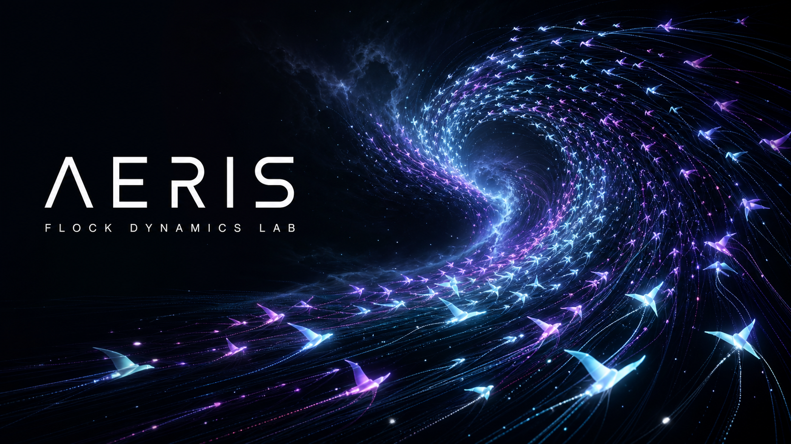

# AERIS — Flock Dynamics Lab

AERIS is a cinematic, real-time boid simulator built with Three.js, React Three
Fiber, custom shaders, and a deterministic typed-array flock engine. It pairs a
scene-first dark interface with deep live tuning, multiple camera systems, and
four reactive environments.



## Highlights

- Deterministic 3D flocking with separation, alignment, cohesion, perception,
  speed, force, turbulence, pointer influence, and boundary tuning.
- GPU-instanced boids with velocity-aware shader color, additive trail buffers,
  bloom, film grain, and vignette post-processing.
- Four authored presets, four camera modes, four environments, pointer attract
  and repel modes, pause, reseed, cinema mode, and fullscreen.
- Responsive control surfaces for desktop and mobile, keyboard shortcuts,
  reduced-motion support, and accessible native controls.
- Automation hooks for deterministic browser verification:
  `window.render_game_to_text()` and `window.advanceTime(ms)`.

## Run locally

Requirements: Node.js 22.13 or newer.

```bash
npm install
make dev
```

Open `http://localhost:4203`.

## Controls

| Input   | Action                                                           |
| ------- | ---------------------------------------------------------------- |
| `Space` | Pause or resume                                                  |
| `R`     | Reseed the flock                                                 |
| `F`     | Toggle fullscreen                                                |
| `C`     | Toggle cinema mode                                               |
| `H`     | Show or hide controls                                            |
| Pointer | Attract or repel the flock, based on the active interaction mode |

## Verification

```bash
make checkall
```

The full gate checks formatting, lint, TypeScript, unit tests, the production
build, and server-rendered application metadata. Pre-commit adds secret scanning
and repeats the relevant language checks.

## Architecture

- `src/simulation/` — deterministic flock engine and spatial neighbor index.
- `src/scene/` — Three.js simulation bridge, instanced rendering, trails,
  environments, camera rig, and post-processing.
- `src/ui/` — responsive controls, presets, telemetry, and browser automation
  seams.
- `src/core/` — shared configuration, presets, types, and state.

## License

MIT
